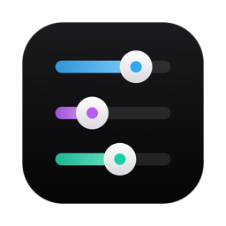
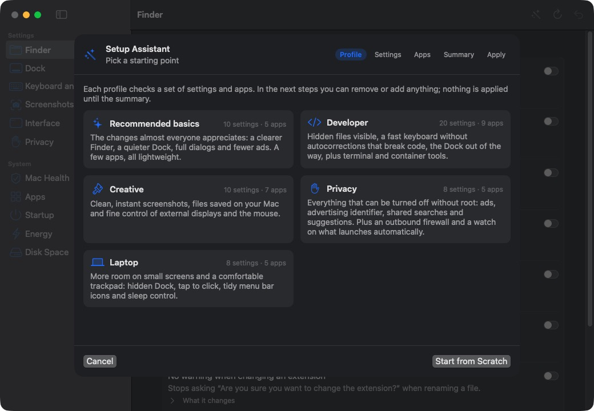
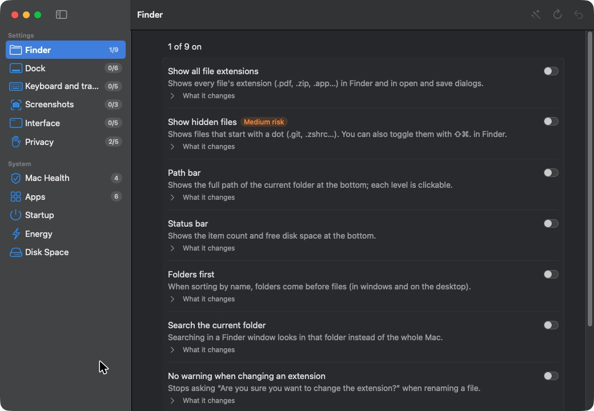
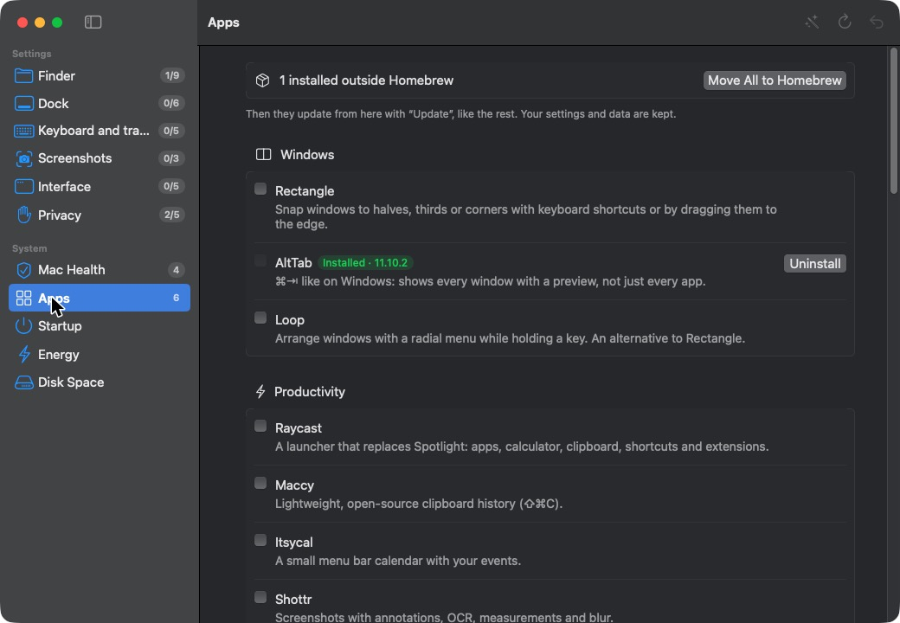
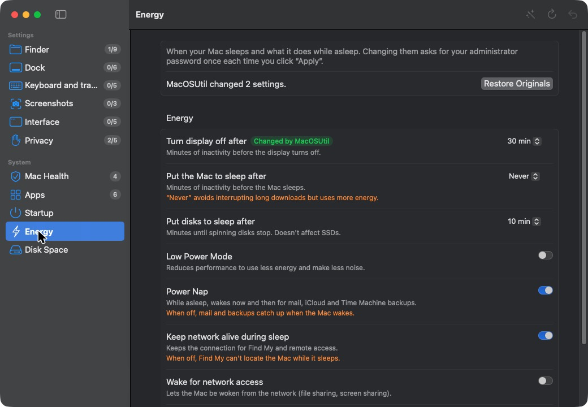

<div align="center">



# MacOSUtil

**Set up a new Mac the way you like it, in minutes, and undo any of it with one click.**

A native macOS utility to tune system settings, install great apps with Homebrew,<br>
tame what runs at startup and keep an eye on your Mac's health.


[](https://github.com/drnagel/MacOSUtil/actions/workflows/catalog.yml)
[](LICENSE)

</div>

<p align="center">
  
</p>

## Why

Every fresh Mac needs the same dozen tweaks, the same handful of apps and the same hunt through System Settings. Tools like this exist on Windows; on the Mac you usually end up pasting `defaults write` commands from a blog post and hoping you can remember how to undo them.

MacOSUtil turns all of that into a clear, reversible checklist:

- **Every change says exactly what it does** — the preference key, the value now and the value after.
- **Every change can be undone** — MacOSUtil remembers the original value and puts it back.
- **Nothing runs as root in the background** — the few actions that need an administrator ask for your password once, and only run from a short, validated list.

## Features

| | |
|---|---|
| 🪄 **Setup Assistant** | Pick a profile — *Recommended basics*, *Developer*, *Creative*, *Privacy* or *Laptop* — review the settings and apps it suggests, and apply everything in one go. |
| ⚙️ **33 system settings** | Finder, Dock, keyboard & trackpad, screenshots, interface and privacy. Things like showing file extensions, an instant Dock, no smart quotes, no floating screenshot thumbnail, no personalized ads… |
| 📦 **Curated apps via Homebrew** | 32 well-known apps (Rectangle, Raycast, Maccy, Ice, Stats, IINA, LuLu, Ghostty, OrbStack…) with live install logs. Apps you installed by hand can be **moved to Homebrew** so they update from here too. |
| 🚀 **Startup control** | See every third-party agent and daemon that launches on its own, how much memory it uses, which app it belongs to and whether it's a leftover from an app you deleted. Disable or re-enable any of them. |
| ⚡️ **Energy** | Display and system sleep, Power Nap, Low Power Mode, wake for network, restart after power failure — with your original values saved. |
| 🩺 **Mac Health** | One read-only page for SIP, FileVault, Gatekeeper, firewall, pending updates, Time Machine, SMART status, free space, memory and battery — with a button to the right System Settings pane. |
| 🔎 **Spotlight per disk** | Turn indexing off on backup or archive drives, or rebuild an index. |
| 💾 **Export & import** | Save your setup to a small `.macosutil.json` file (no personal data) and apply it on your next Mac. Reapply your last setup after a macOS update. |
| 🌐 **English & Spanish** | Follows your Mac's language; English everywhere else. |

<table>
  <tr>
    <td></td>
    <td></td>
  </tr>
  <tr>
    <td align="center"><sub>Settings explain what they change</sub></td>
    <td align="center"><sub>Curated apps, installed with Homebrew</sub></td>
  </tr>
</table>

<p align="center">
  
</p>

## How it stays safe

- **Declarative catalog.** Settings, apps and profiles live in plain JSON under [`Catalog/`](Catalog). A setting can only write preference values; it can never run a command. Links can only open System Settings panes.
- **Originals are always saved.** Before writing a preference, MacOSUtil records its current value in `~/Library/Application Support/MacOSUtil/`. *Restore All* puts every one back.
- **Administrator actions are a closed list.** Disabling a system daemon, changing `pmset` values or Spotlight indexing runs through a small set of validated commands. Apple services, paths outside `/Library/LaunchDaemons` and out-of-range values are rejected before macOS even asks for your password.
- **The catalog is signed.** Catalog updates are downloaded only when you ask, and only accepted if they carry a valid Ed25519 signature, a newer version number and pass the same validation as the built-in catalog.
- **No telemetry.** The app talks to the network only when Homebrew installs something or when you check for catalog updates.

## Requirements

- macOS 15 Sequoia or later (tested up to macOS 27)
- Apple silicon or Intel
- [Homebrew](https://brew.sh) for installing apps (optional — everything else works without it)

## Build & run

MacOSUtil is a Swift package; you only need the Xcode Command Line Tools.

```bash
git clone https://github.com/drnagel/MacOSUtil.git
cd MacOSUtil
Scripts/build.sh --run        # build build/MacOSUtil.app and open it
Scripts/build.sh --install    # or copy it to /Applications
```

`build.sh` signs the app with a local certificate if you have one (set `MACOSUTIL_SIGN_ID`), or ad-hoc otherwise.

Run the self-test to check everything against your Mac without changing anything permanent:

```bash
build/MacOSUtil.app/Contents/MacOS/MacOSUtil --selftest
```

## The catalog

```
Catalog/
├── catalog.json          # catalog version
├── tweaks/               # one file per category: Finder, Dock, Keyboard…
├── apps.json             # curated apps (Homebrew casks or App Store ids)
└── profiles/             # Setup Assistant profiles
```

Every visible text is bilingual:

```json
{
  "id": "finder.show-extensions",
  "title": { "en": "Show all file extensions", "es": "Mostrar todas las extensiones" },
  "description": { "en": "Shows every file's extension…", "es": "Muestra la extensión de cada archivo…" },
  "tested": "27",
  "actions": [{ "type": "defaults", "domain": "NSGlobalDomain", "key": "AppleShowAllExtensions", "valueType": "bool", "value": true }],
  "restart": ["Finder"]
}
```

`tested` is the latest macOS version the setting was checked on; on newer versions the app shows a *Not tested* badge. Apps get their minimum macOS from Homebrew and can't be selected on older systems.

Want to add a setting or an app? See [CONTRIBUTING.md](CONTRIBUTING.md). Every pull request is validated automatically.

## Translations

The app follows your Mac's language: Spanish on a Mac set to Spanish, English everywhere else. Interface texts live in [`Localization/en.json`](Localization/en.json) (keyed by the Spanish text in the source code) and the build fails if any translation is missing. Catalog texts carry their own `en` and `es` values.

## Companion app

MacOSUtil leaves disk analysis and cleanup to **DiskTree**, a separate disk space app. When DiskTree is installed, *Disk Space* opens it right on the tab or folder you pick through `disktree://` links.

## Roadmap

- [ ] Menu bar widget with memory, CPU and disk
- [ ] More settings and apps in the catalog
- [ ] More languages

## License

[MIT](LICENSE)
